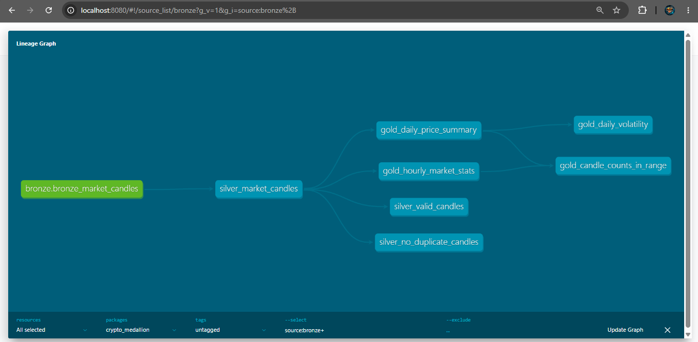

# Crypto Medallion Pipeline

An end-to-end data engineering project that ingests public cryptocurrency market data through near-real-time and batch pipelines, stores it in ClickHouse, and transforms it using a Medallion Architecture (bronze, silver, gold).

## Architecture

- **Apache NiFi:** Near-real-time ingestion. Polls the Binance public klines REST API every 60 seconds, splits the response into individual candles, and inserts only closed candles into ClickHouse bronze. The forming candle is dropped so partial data never lands.
- **Apache Airflow:** Orchestrates the daily batch pipeline (`crypto_medallion_pipeline` DAG): reload historical candles into bronze, then run and test the dbt models. A separate `historical_crypto_ingestion` DAG loads only the batch data and is triggered manually.
- **dbt:** Builds and tests silver and gold transformation models (ELT inside ClickHouse).
- **ClickHouse:** Stores bronze, silver, and gold analytical tables.
- **Docker Compose:** Provides a reproducible local environment.
- **GitHub Actions:** Continuous integration. Builds and tests the dbt models against a temporary ClickHouse on every push.

```
Binance REST API (history) -> Airflow + Python -> ClickHouse bronze
Binance REST API (live)    -> NiFi              -> ClickHouse bronze
ClickHouse bronze -> dbt -> silver -> dbt -> gold
```



## Data Scope

- Market: BTC/USDT
- Interval: 1-minute candles
- Batch history: rolling window of approximately 30 days
- Live: one poll per minute; closed candles only

## Medallion Layers

- **Bronze** (`bronze_market_candles`): Raw candles from both sources, append-only. Rows carry a `source` tag (`batch` or `nifi`) and an `ingested_at` timestamp. Overlapping live polls and batch/live overlap can create duplicate candles here by design.
- **Silver** (`silver_market_candles`): Closed candles with sanity checks applied (positive prices, high >= low, non-negative volume), deduplicated to one row per `(symbol, interval, open_time)`, keeping the most recently ingested copy.
- **Gold:**
  - `gold_daily_price_summary`: daily open, high, low, close, volume, trades, price change and percent change, with a flag for complete days (1,440 candles).
  - `gold_hourly_market_stats`: hourly OHLC, volume and trades, with a flag for complete hours (60 candles).
  - `gold_daily_volatility`: daily high-low range as a percent of the open, a 7-day average range, and volume relative to the 7-day average (complete days only).

## Data Quality

dbt tests run with `dbt test` (13 tests): not-null checks on key columns, uniqueness of the daily volatility key, no duplicate candles in silver, valid price and volume values in silver, and sanity limits on candle counts per day and per hour in gold.

## Handling Gaps

The live NiFi flow can only collect while it is running, so downtime leaves gaps. The daily batch run re-pulls the last 30 days and replaces its own `batch` rows without touching `nifi` rows. Silver deduplicates any overlap, so the batch reload heals gaps with no duplicates downstream.

## CI/CD

- **CI (implemented):** The GitHub Actions workflow in `.github/workflows/dbt-ci.yml` starts a temporary ClickHouse, creates the bronze table from `clickhouse/init/`, loads synthetic candles (deliberately duplicated across both sources), then runs `dbt run` and `dbt test`. A broken model or failing test turns the push red.
- **CD (future work):** There is no server to deploy to, since the stack runs locally in Docker. With a target environment, a deploy job would run after CI passes on `main` and update the DAGs and dbt project there.

## Project Structure

- `nifi/flows/`: Exported NiFi flow definition (`Binance_Live_Market_Ingestion.json`).
- `airflow/dags/`: Airflow DAGs (`crypto_medallion_pipeline.py`, `historical_crypto_ingestion.py`).
- `airflow/Dockerfile`: Airflow image with dbt installed in its own virtual environment.
- `clickhouse/init/`: ClickHouse initialization scripts (bronze table DDL), run automatically on first start of an empty volume.
- `dbt/`: dbt project (`models/sources.yml`, `models/silver/`, `models/gold/`, `models/schema.yml`, `tests/`).
- `scripts/`: Supporting scripts (historical candle loader).
- `docs/`: Architecture documentation and the dbt lineage screenshot.
- `.github/workflows/`: CI workflow.

## Running Locally

1. Copy `.env.example` to `.env` and set the passwords. NiFi requires a password of at least 12 characters.
2. Build and start the services: `docker compose up -d --build`
3. Import `nifi/flows/Binance_Live_Market_Ingestion.json` into NiFi (https://localhost:8443/nifi), set the ClickHouse password on the final InvokeHTTP processor, and start the process group.
4. In Airflow (http://localhost:8082), unpause and trigger the `crypto_medallion_pipeline` DAG. It loads bronze, then builds and tests silver and gold.
5. Optional, to run dbt from your own machine: `pip install dbt-core dbt-clickhouse`, then from the `dbt/` folder, with `CLICKHOUSE_PASSWORD` set as an environment variable, run `dbt run --profiles-dir .` and `dbt test --profiles-dir .`

## Status

- Bronze batch ingestion (Airflow): done
- Bronze live ingestion (NiFi): done
- Silver and gold models (dbt): done
- dbt tests and lineage docs: done
- dbt scheduled through Airflow: done
- CI with GitHub Actions: done
- CD: future work